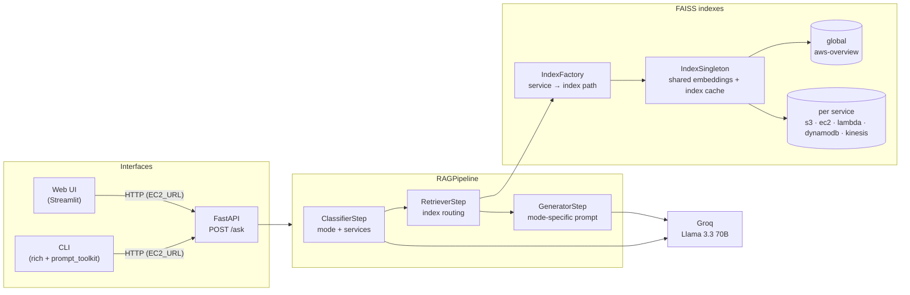
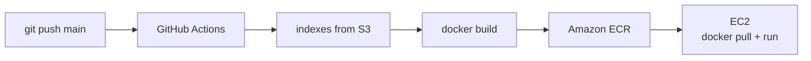

# AWS Documentation RAG Assistant

A Retrieval-Augmented Generation (RAG) assistant that answers questions about AWS services from the official AWS documentation (PDFs).
Each question is first classified (general "discovery" question vs. precise "technical" question, and which AWS service it targets), then routed to the matching FAISS index before an LLM (Llama 3.3 70B served by Groq) generates the answer.
The assistant is exposed through a FastAPI backend, a terminal CLI and a Streamlit web interface, and is deployed on AWS EC2 through a GitHub Actions CI/CD pipeline.

> Note: the prompts (classification, generation, evaluation) are currently written in French, so the assistant answers in French.

## Architecture



### How a question is answered

1. **`ClassifierStep`** asks the LLM to return a JSON object `{"mode": "discovery" | "technical", "services": [...]}`. If the JSON is invalid, it falls back to `discovery` with no service.
2. **`RetrieverStep`** picks the index:
   - `technical` question **and** the first detected service is a known service → that service's index, top-k = 6;
   - otherwise → the global index, top-k = 4.
3. **`GeneratorStep`** builds the prompt from the retrieved chunks and uses a different prompt per mode: `discovery` recommends services in a few lines, `technical` answers precisely (CLI commands / code formatted in Markdown) based only on the provided documentation.

### Indexing

`app/indexer.py` builds one FAISS index per PDF:

| Source PDF | Index |
|---|---|
| `data/global/aws-overview.pdf` | `indexes/global` |
| `data/services/<service>.pdf` (s3, ec2, lambda, dynamodb, kinesis) | `indexes/services/<service>_index` |

- Chunking: `RecursiveCharacterTextSplitter`, chunk size 800, overlap 150 (characters).
- Embeddings: `sentence-transformers/all-MiniLM-L6-v2` on CPU (Hugging Face).

All parameters live in `config/settings.py`.

## Design choices

- **Routing questions by service.** Instead of one large index over all the documentation, each service has its own index. Technical questions are searched only in the documentation of the service they are about, which keeps the retrieved context focused; open questions use a global overview index.
- **Factory pattern — `IndexFactory`.** `IndexFactory.create(service)` hides how a service name maps to an index on disk (unknown services fall back to the global index). The pipeline only asks for "the index of service X".
- **Singleton pattern — `IndexSingleton`.** The embedding model is loaded once, and every loaded FAISS index is cached by path, so repeated questions do not reload models or indexes from disk.
- **Step-based pipeline.** Every step implements the abstract `BaseStep.execute(context) -> context` and reads/writes a shared context dict. `RAGPipeline` simply runs the list of steps, so a step can be added, replaced or tested on its own.
- **Interchangeable interfaces.** CLI and web interfaces implement the same abstract `AppInterface` (`start`, `getInput`, `displayResponse`, `processQuestion`). Both are thin HTTP clients of the FastAPI backend: they send the question to `POST /ask` and display the answer, so the LLM and the indexes only run in the backend.

## Project structure

```
.
├── api.py                  # FastAPI backend (POST /ask, GET /health)
├── main.py                 # Entry point: CLI, or web UI under `streamlit run`
├── app/
│   ├── indexer.py          # Builds the FAISS indexes from the PDFs
│   ├── index/              # IndexFactory + IndexSingleton
│   ├── pipeline/           # BaseStep, ClassifierStep, RetrieverStep, GeneratorStep, RAGPipeline
│   └── interfaces/         # AppInterface, CLIInterface, WebInterface
├── config/                 # settings.py (paths, chunking, top-k, LLM, embeddings)
├── evaluation/             # LLM-as-judge evaluation script + dataset
├── Dockerfile              # Image serving the FastAPI backend
├── docker-compose.yml
└── .github/workflows/deploy.yml   # CI/CD: build → ECR → EC2
```

`data/` (PDFs) and `indexes/` (FAISS files) are not versioned.

## Getting started

### Prerequisites

- Python 3.11 (version used by the Docker image)
- A [Groq](https://console.groq.com/) API key
- The AWS documentation PDFs, placed as described in [Indexing](#indexing)
  TODO: add the source links of the PDFs used.

### Local setup

```bash
python -m venv venv
source venv/bin/activate
pip install -r requirements.txt

cp .env.example .env        # then set GROQ_API_KEY

python -m app.indexer       # builds indexes/ from data/
```

### Run

```bash
# 1. Start the backend
uvicorn api:app --port 8000

# 2. In another terminal, start the CLI (talks to EC2_URL, default http://localhost:8000)
python main.py

# ...or the web interface (same backend), on http://localhost:8501
streamlit run main.py
```

Or query the API directly:

```bash
curl -X POST http://localhost:8000/ask \
     -H "Content-Type: application/json" \
     -d '{"question": "Comment créer un bucket S3 avec AWS CLI ?"}'
```

### Docker

The image only contains the backend (FastAPI on port 8000). The indexes are copied into the image at build time, so build them locally first.

```bash
docker build -t rag-aws-assistant .
docker run -p 8000:8000 --env-file .env rag-aws-assistant
```

With docker-compose (reads `GROQ_API_KEY`, `AWS_REGION`, `S3_BUCKET_NAME` from `.env`):

```bash
docker compose up --build
```

The API is then available on http://localhost:8000.

## Evaluation

`evaluation/evaluate.py` uses an **LLM-as-judge** approach: for each question of `evaluation/eval_dataset.py`, it runs classification, retrieval and generation, then asks the LLM (the same Groq Llama 3.3 70B) to give two scores between 0 and 1:

- **Faithfulness**: is the answer grounded only in the retrieved context?
- **Answer relevancy**: does the answer actually address the question?

The script reports the average of each metric and a global score (mean of the two), against a target of 0.75.

```bash
python evaluation/evaluate.py
```

### Results

Extended evaluation in progress.

**Honest note:** the current evaluation set only contains **3 questions**, so its scores are only a sanity check, not a reliable measure of quality. In addition:

- the judge is the same model as the generator, which can bias scores upward;
- to limit token usage, the judge only sees the first 500 characters of the context and the first 300 characters of the answer;
- if the judge's reply cannot be parsed as a number, the score defaults to 0.5;
- the `ground_truth` answers in the dataset are not used by the metrics yet.

## CI/CD

`.github/workflows/deploy.yml` runs on every push to `main`:

1. Configure AWS credentials (`AWS_ACCESS_KEY_ID`, `AWS_SECRET_ACCESS_KEY` GitHub secrets, region `eu-west-1`).
2. Download the FAISS indexes from **S3** (`s3://<S3_BUCKET_NAME>/indexes`, bucket name stored in the `S3_BUCKET_NAME` GitHub secret).
3. Log in to **Amazon ECR**.
4. Build the Docker image and push it to the `rag-aws-assistant` ECR repository, tagged with the commit SHA and `latest`.
5. SSH into the **EC2** instance (`EC2_HOST`, `EC2_SSH_KEY` secrets), pull `latest`, and restart the `rag-assistant` container with the instance's own `.env` file.



### Why the indexes come from S3

`indexes/` and `data/` are git-ignored (binary files, ~86 MB and ~144 MB), so they are not in the GitHub Actions checkout, while the Dockerfile needs `indexes/` to build the image. The workflow therefore downloads the prebuilt indexes from S3 right before `docker build`:

- the CI job already has AWS credentials and the AWS CLI, so no application code changes;
- the image stays self-contained: the container starts fast and needs no AWS credentials at runtime;
- building the indexes at container startup was ruled out: the source PDFs are not in the image either, and computing the embeddings on every start would be slow.

After rebuilding the indexes locally, upload them once:

```bash
aws s3 sync indexes/ s3://<your-bucket>/indexes/
```

## Limitations and known issues

- **Small evaluation set** (3 questions), with the biases listed above.
- **Single-service routing**: only the first detected service is used; a question comparing two services in technical mode is searched in one index only.
- **Limited scope**: five services (S3, EC2, Lambda, DynamoDB, Kinesis) plus a global overview; French-only prompts.
- FAISS indexes are loaded with `allow_dangerous_deserialization=True` (pickle): only load indexes you built yourself.

## Next steps

- Grow the evaluation set (more questions, every service, both modes) and use the `ground_truth` answers.
- Expose the retriever as an **MCP server**, so that any MCP-compatible agent can query the AWS documentation indexes.
- Retrieve from several service indexes when a question involves more than one service.

## License

This project is licensed under the Apache License 2.0 — see [LICENSE](LICENSE).
